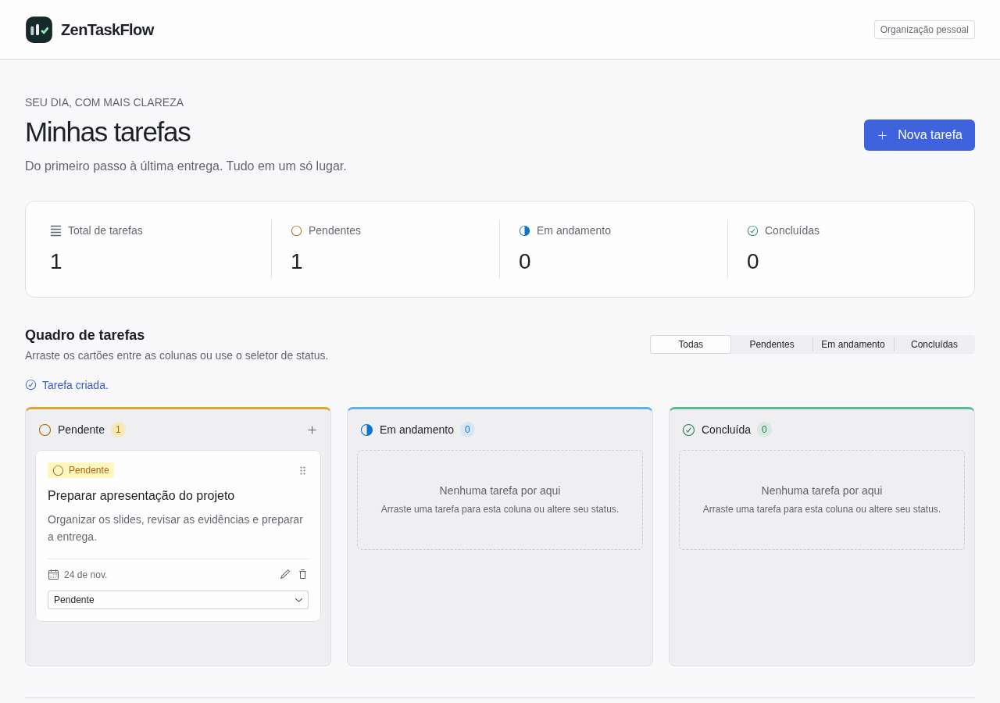

<p align="center">
  
</p>

# ZenTaskFlow

Aplicação acadêmica de gerenciamento de tarefas desenvolvida para a disciplina de Gerência de Configuração e Manutenção de Software.

O ZenTaskFlow ajuda a organizar atividades e acompanhar o progresso em um quadro Kanban simples. O projeto usa versionamento, testes automatizados e integração e entrega contínuas com GitHub Actions.

[Acessar aplicação publicada](https://devcaverna.github.io/zen-taskflow/)

## Veja o ZenTaskFlow em ação

Uma tarefa passando de **Pendente** para **Em andamento** e depois para **Concluída**, com os indicadores atualizados automaticamente.



[Ver imagem estática da tela principal](media/zen-taskflow-preview.png).

A demonstração foi capturada na aplicação real, em uma sessão isolada com uma tarefa de exemplo. A aplicação inicia sem tarefas predefinidas.

## Funcionalidades

- Cadastro com título obrigatório e descrição opcional.
- Status inicial Pendente.
- Quadro com colunas Pendente, Em andamento e Concluída.
- Movimentação por arrastar no desktop ou pelo seletor de status.
- Edição, exclusão com confirmação e filtros por status.
- Indicadores de quantidade atualizados imediatamente.
- Persistência em LocalStorage.
- Validações na lógica: título de até 100 caracteres, descrição de até 500 e rejeição de status inválidos.
- Interface em português do Brasil, com componentes Radix e layout responsivo.
- Status com texto, ícone e cores: âmbar, azul e verde.

## Tecnologias

Node.js 22 ou superior, React, TypeScript, Vite, Radix Themes, Radix Icons, LocalStorage, Vitest e ESLint.

Não há backend, autenticação, banco remoto ou comunicação com serviços externos.

## Instalação e execução

Clone o repositório e execute:

```bash
git clone https://github.com/DevCaverna/zen-taskflow.git
cd zen-taskflow
npm ci
npm run dev
```

Abra o endereço informado pelo Vite, normalmente http://localhost:5173.

## Verificações e build

```bash
npm run test
npm run lint
npm run build
```

Os testes executam uma única vez, sem modo watch, e usam a lógica real da aplicação. O build verifica os tipos e gera os arquivos estáticos em `dist/`.

## Integração e entrega contínuas

O workflow roda em pull requests com destino à `main`, em pushes na `main` e por execução manual. O job `build` (`Test, lint and build`) instala as dependências com `npm ci`, executa os testes e o lint, gera o build e envia `dist/` como artefato do GitHub Pages. [Workflow CI/CD](.github/workflows/ci-cd.yml)

O job `deploy` (`Deploy to GitHub Pages`) tem uma condição que exige um push na `main`. Por isso, o deploy é pulado mesmo em PRs aprovados nas verificações. Em um push na `main`, `needs: build` exige que o job de validação termine com sucesso. Se esse job falhar, o deploy é pulado.

- Aplicação publicada no GitHub Pages em <https://devcaverna.github.io/zen-taskflow/>.
- Execuções e evidências: [GitHub Actions](https://github.com/DevCaverna/zen-taskflow/actions)
- Fluxo sugerido: crie uma branch, abra um pull request, corrija eventuais falhas indicadas pelas verificações e integre apenas quando o workflow estiver verde.

### Demonstração da atividade Operação Deploy

1. **Falha intencional em pull request.** Em `tests/task.service.test.ts`, o teste “cadastra tarefa válida como Pendente, com ID e data automáticos” foi alterado para esperar o ID `demo-failure`, mas recebeu um UUID gerado pela aplicação. A etapa `Run tests` terminou com 1 teste reprovado e 21 aprovados. A falha interrompeu o fluxo antes de gerar o artefato. As etapas `Lint`, `Build` e `Upload Pages artifact` foram puladas. O job de deploy também foi pulado, pois a execução ocorreu em um PR. [Execução com falha](https://github.com/DevCaverna/zen-taskflow/actions/runs/45486734519) · [Job de validação](https://github.com/DevCaverna/zen-taskflow/actions/runs/45486734519/job/138774005473)
2. **Correção no pull request.** Os 22 testes passaram e as etapas de lint, build e envio do artefato terminaram com sucesso. O job de deploy foi pulado pela condição de publicação. [Execução da correção](https://github.com/DevCaverna/zen-taskflow/actions/runs/45486877852)
3. **Publicação após push na `main`.** As verificações e o envio do artefato terminaram com sucesso. O job de deploy executou a etapa `Publish site` e publicou a aplicação no GitHub Pages. [Execução da publicação](https://github.com/DevCaverna/zen-taskflow/actions/runs/45487133512)

## Estrutura

```text
media/                   # GIF e captura da aplicação para este README
src/
├── assets/
│   └── zen-taskflow-logo.svg
├── components/
│   ├── TaskBoard.tsx
│   └── TaskForm.tsx
├── services/task.service.ts
├── types/task.ts
├── App.tsx
├── main.tsx
└── styles.css
tests/
└── task.service.test.ts
```

A lógica de gerenciamento, validação e persistência é independente dos componentes visuais.

## Limitações

Os registros ficam apenas no navegador e na origem em uso. Limpar o armazenamento apaga os dados. Não há sincronização entre abas ou dispositivos, backup, contas ou recuperação. Alterações em abas simultâneas podem sobrescrever dados.

Falhas de gravação não aplicam a alteração na tela. Dados salvos que não possam ser lidos bloqueiam novas gravações para evitar sobrescrever conteúdo potencialmente recuperável. Evite guardar informações sensíveis.

O arrastar usa o recurso nativo do navegador. No celular e por teclado, utilize o seletor de status.

## Equipe

- Luiz Otavio Faria da Silva
- André Ricardo Born De Amorim
- Kawan Harshe Kakubo
